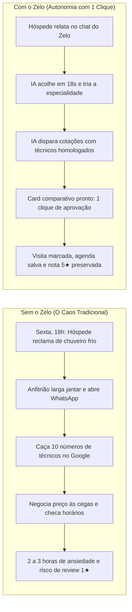

# Zelo — Pitch & Visão Executiva

> **"Quebrou algo no imóvel? A gente resolve de ponta a ponta. Você só aprova."**

---

## 1. O Que É o Zelo? (Executive Summary)

O **Zelo** é o primeiro **co-anfitrião de operações autônomo** projetado para anfitriões e administradores profissionais de imóveis de temporada (Airbnb e Booking). 

Quando um incidente físico ocorre no imóvel — como um chuveiro queimado, uma torneira vazando ou o ar-condicionado inoperante —, o Zelo assume toda a cadeia de resolução:
1. **Atende o hóspede** com acolhimento e empatia imediata via chat web dedicado;
2. **Diagnostica o problema** e minera prestadores locais homologados;
3. **Cota orçamentos e disponibilidade** ativamente no WhatsApp com técnicos da região;
4. **Entrega uma proposta comparada** para o gestor aprovar com **1 clique** no celular;
5. **Fecha a agenda, sincroniza o calendário** do imóvel e notifica o hóspede com as instruções de entrada na portaria.

Tudo isso acontece em **menos de 45 segundos de tempo ativo do anfitrião**, garantindo a nota 5 estrelas e eliminando o pânico operacional.

---

## 2. O Objetivo da Ideia (Missão & Visão)

### A Missão
Eliminar o atrito operacional, a sobrecarga de mensagens no WhatsApp e o risco de prejuízos financeiros causados por manutenções emergenciais no aluguel por temporada, devolvendo a paz de espírito ao anfitrião.

### A Visão
Construir o **sistema operacional invisível da hospitalidade flexível**, conectando hóspedes, imóveis inteligentes e prestadores locais de serviços de forma 100% autônoma, segura e governada por humanos.

---

## 3. A Dor Real do Mercado (Embasada em Evidências)

A dor atacada pelo Zelo não é uma hipótese teórica. Ela é sustentada por pesquisas de grande escala e pelas regras contratuais das plataformas de hospedagem (detalhado em [`docs/FONTES_PROBLEMATICA.md`](docs/FONTES_PROBLEMATICA.md)):

* **15,1% das Queixas Envolvem Falhas Físicas:** Um estudo da *Hosthub* analisando **1 milhão de mensagens de hóspedes** constatou que **8,78%** de todas as ocorrências são relacionadas a banheiros e **6,36%** a eletrodomésticos com defeito.
* **A Causa Central das Avaliações Negativas:** Estudo acadêmico publicado na *Frontiers in Psychology (2021)* examinando **59.766 avaliações de 27.980 anúncios em 12 cidades** identificou problemas em banheiros, conservação, equipamentos e temperatura como os principais temas de insatisfação dos hóspedes.
* **Hemorragia Financeira nas Políticas Oficiais:** De acordo com os Artigos 2868 e 990 do Airbnb:
  * Falhas em comodidades anunciadas garantem ao hóspede **reembolso parcial ou integral** debitado dos repasses do anfitrião (*AirCover*);
  * Cancelamentos motivados por problemas graves de manutenção acarretam taxas punitivas de **até 50% das noites restantes** e rebaixamento do anúncio no algoritmo de buscas (*SEO interno do Airbnb*).

---

## 4. O Antes vs. O Depois do Zelo



---

## 5. A Experiência dos Três Atores

| Ator | Canal de Contato | Como Vivencia o Zelo |
| :--- | :--- | :--- |
| **Hóspede / Camareira** | Chat Web Mobile do Imóvel (sem app) | Relata a queixa de forma natural. É acolhido com empatia em segundos, responde apenas 1 pergunta técnica essencial e recebe um cartão seguro com data, hora e dados do prestador. |
| **Prestador de Serviço** | WhatsApp Direto | Recebe a solicitação formatada por texto (ex: *"Serviço elétrico em Cabo Branco: chuveiro frio"*), responde preço e horário em linguagem natural, sem precisar instalar aplicativo algum. |
| **Anfitrião / Gestor** | Dashboard Web do Zelo | Recebe notificação com o card comparativo (preços, notas e horários cruzados com o calendário da estadia) e clica em **"Aprovar Carlos · R$ 180"**. |

---

## 6. O Diferencial Tecnológico: Por que Agentes de IA?

O Zelo não é um assistente de texto superficial; é uma **rede de agentes de alta precisão orientada a estados**:

1. **Roteador Determinístico de Custo Zero:** Separa instantaneamente dúvidas comerciais e de regras do imóvel (encaminhadas ao Nó 1) de relatos de falhas físicas (encaminhadas ao Nó 2).
2. **Nó 2 (Validador Canônico):** Extrai a especialidade (encanador, eletricista, técnico de ar), urgência e cômodo através de schemas estritos tipados em **Pydantic v2**.
3. **Nó S (Scraper Contínuo com Agent Browser):** Utiliza o *Agent Browser da Vercel* para minerar prestadores no Google Maps sem depender de chaves caras de API, valida o WhatsApp ativo e armazena apenas contatos confirmados com mascaramento LGPD.
4. **Nó 3 (Resolvedor em LangGraph com Human-in-the-Loop):**
   * Controla esperas assíncronas de orçamentos e timeouts;
   * Pausa a execução no nó de `interrupt` para a decisão soberana do anfitrião;
   * Aplica a matriz **Urgência × Agenda** (urgência crítica entra no mesmo dia com aviso ao hóspede; manutenção estética aguarda a janela vaga entre estadias);
   * Retoma o grafo assincronamente após o clique humano e encerra o chamado.

---

## 7. Oportunidade de Mercado (TAM / SAM / SOM)

* **TAM (Total Addressable Market):** **US$ 112 Bilhões**  
  Mercado global de gestão operacional e manutenção para o setor de locação por temporada até 2030 (crescimento de 11.2% CAGR).
* **SAM (Serviceable Addressable Market):** **R$ 8,4 Bilhões**  
  Gastos anuais em manutenção e suporte operacional em mais de **450.000 imóveis ativos** no Airbnb e Booking no Brasil e América Latina.
* **SOM (Serviceable Obtainable Market - Foco Inicial):** **R$ 420 Milhões ARR**  
  Meta de captura focada em **12.000 gestores multi-imóveis profissionais** (carteiras de 5 a 50 propriedades) concentrados nos maiores pólos turísticos do país (São Paulo, Rio de Janeiro, Nordeste e Santa Catarina).

---

## 8. Modelo de Negócio & Unit Economics

O Zelo opera em um modelo híbrido de alta margem e previsibilidade:

### Fluxos de Receita
* **SaaS B2B por Imóvel Ativo:** **R$ 49,00 / mês** por propriedade. Garante atendimento 24/7, roteador de mensagens, governança de reservas e acesso ao banco de prestadores homologados.
* **Take-Rate por Sucesso (OS):** **R$ 15,00** por ordem de serviço de manutenção resolvida ponta a ponta.

### Indicadores Unit Economics
* **LTV Projetado:** **R$ 3.820** (36 meses de retenção média com churn < 1.2% ao mês — o anfitrião que evita um estorno nunca cancela a ferramenta).
* **CAC Blend:** **R$ 480** (aquisição orgânica via parcerias com Property Management Systems como Guesty/Hospedin e comunidades de Superhosts).
* **Eficiência de Capital (LTV / CAC):** **7.9x** (padrão de referência internacional para investimentos Seed).
* **Margem Bruta de Software:** **82%** (custo computacional de inferência LLM otimizado para menos de R$ 0,74 por ordem orquestrada).

---

## 9. Segurança, Governança e Blindagem LGPD

* **Human-in-the-Loop Real:** A IA nunca contrata, agenda ou efetua pagamentos sem a aprovação explícita do anfitrião.
* **Proteção contra Prompt Injection:** Entradas de hóspedes e prestadores passam por sanitização rígida antes de qualquer invocação aos modelos de linguagem.
* **Privacidade Absoluta:** Telefones de hóspedes e prestadores ficam restritos ao banco de dados PostgreSQL e são **mascarados** antes de qualquer log ou envio de telemetria ao Langfuse.
* **Contabilidade Preventiva de Custos:** Sistema de corte automático (`MAX_COST_PER_RUN_USD = US$ 0,03`) para garantir previsibilidade financeira aos desenvolvedores e gestores.

---

## 10. Como Experimentar o Zelo Agora

1. **Apresentação do Pitch Interativo:**  
   Abra o arquivo [`pitch.html`](pitch.html) em qualquer navegador para visualizar o deck executivo de 8 slides (compatível com navegação por teclado e tela cheia).
2. **Ambiente Completo via Docker Compose:**
   ```bash
   docker compose -f infra/docker-compose.yml up --build
   ```
   Acesse a aplicação em `http://localhost:5173` e a documentação interativa da API em `http://localhost:8000/docs`.
3. **Reset para Avaliadores:**  
   O sistema conta com um botão **"Resetar Dados"** na barra superior (ou via chamada `POST /api/demo/reset`) para restaurar instantaneamente um cenário limpo de testes para bancas avaliadoras.

---

## 11. Links e Documentação de Apoio

* **Apresentação Pitch Deck:** [`pitch.html`](pitch.html)
* **Plano Completo de Arquitetura e Engenharia:** [`docs/PLAN.md`](docs/PLAN.md)
* **Status Atualizado de Desenvolvimento:** [`docs/STATUS.md`](docs/STATUS.md)
* **Fontes Empíricas da Problemática:** [`docs/FONTES_PROBLEMATICA.md`](docs/FONTES_PROBLEMATICA.md)
* **Concepção e Filosofia da Marca:** [`docs/CONCEITO_ZELO.md`](docs/CONCEITO_ZELO.md)
* **Guia de Deploy em Produção:** [`docs/DEPLOY.md`](docs/DEPLOY.md)