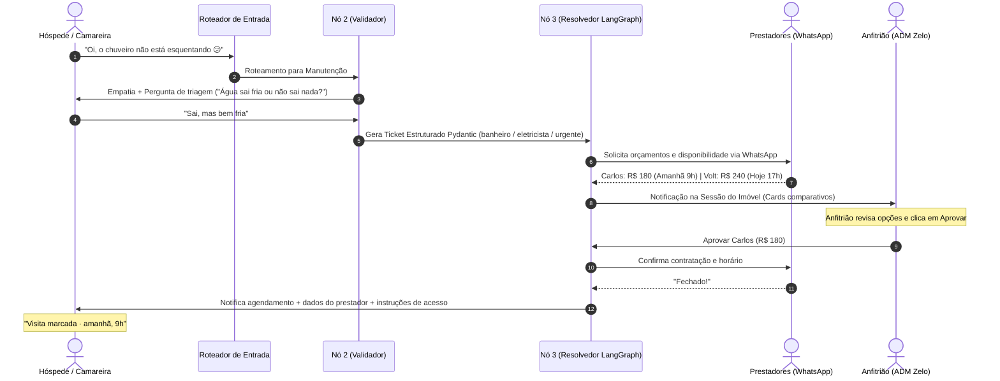
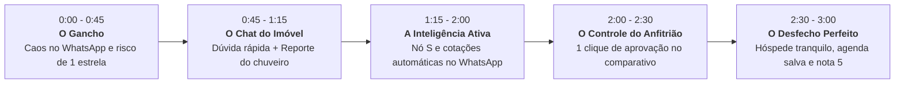

# Zelo — Concepção do Produto e Documento Mestre de Visão

> **"Quebrou algo no imóvel? A gente resolve. Você só aprova."**

---

## 1. Identidade e Posicionamento

* **Nome do Produto:** **Zelo**
* **Conceito:** Zelo significa cuidar com atenção e dedicação. A marca traduz sofisticação, acolhimento e confiança. A tecnologia trabalha de forma silenciosa e invisível nos bastidores; o que aparece para o usuário é o resultado tangível e a paz de espírito.
* **Símbolo:** A casa (o imóvel) acolhendo um ponto âmbar no centro (o problema que está sendo ativamente cuidado pela inteligência).
* **Paleta Visual:**
  * **Mar Profundo (`#17323A`):** Cor predominante institucional, textos, botões principais de ação e molduras.
  * **Areia (`#F6F3EE`):** Fundo acolhedor, superfícies neutras e respirações de tela (estilo boutique/Airbnb contemporâneo).
  * **Âmbar (`#F2A541`):** Destaque de status, notificações ativas, badges de atenção e cartões de visita marcada.
  * **Branco Puro (`#FFFFFF`):** Superfícies de cards e balões de chat do assistente.
* **Tipografia:** *Plus Jakarta Sans* (títulos marcantes, números e cards de destaque) e *Inter* (corpo de texto, inputs e mensagens de chat).

---

## 2. O Problema e o Cliente Ideal (ICP)

### O ICP (Ideal Customer Profile)
* **Perfil:** Gestor Multi-imóveis / Superhost Profissional (gestão de 5 a 30 imóveis de temporada no Airbnb/Booking).
* **Gargalo Principal:** Caos operacional e falta de tempo. Cada incidente durante uma estadia drena horas de WhatsApp, busca cega por profissionais e estresse.
* **Maior Risco:** Uma torneira com vazamento ou chuveiro frio não resolvidos a tempo resultam em **avaliação de 1 estrela**, cancelamento com reembolso forçado pelo Airbnb e perda de relevância do anúncio por meses.

### A Proposta de Valor
> **O Co-anfitrião de Operações Autônomo:**  
> Transforma 2 horas de mensagens caóticas no WhatsApp em **1 clique de aprovação**. O anfitrião apenas seleciona a melhor proposta comparada e o Zelo orquestra todo o resto com o prestador e o hóspede.

---

## 3. Jornada dos Três Atores

### Ator 1: O Hóspede ou Camareira (Chat Mobile do Zelo)
* **Acesso:** Direto pelo chat web responsivo do Zelo dedicado àquele imóvel (ex: `/imovel/apto-302-cabo-branco`).
* **Triagem Acolhedora e Curta:** O agente nunca submete o usuário a um questionário burocrático. Expressa empatia imediata, faz no máximo 1 ou 2 perguntas indispensáveis para determinar a especialidade técnica (ex: se é hidráulica ou elétrica) e tranquiliza.
* **Tratamento Uniforme:** Relatos de hóspedes e camareiras seguem o mesmo canal simplificado; o sistema extrai o problema técnico e a urgência diretamente pelo contexto relatado.
* **Transparência e Segurança:** Quando o conserto é agendado, o hóspede recebe um card com o nome do prestador, horário previsto e instruções de acesso (ex: "o prestador pegará a chave na portaria"), eliminando qualquer preocupação de invasão de privacidade.

### Ator 2: O Prestador de Serviços (WhatsApp Simulado)
* **Canal Prático:** O prestador não precisa baixar aplicativo. Recebe uma mensagem direta e profissional no WhatsApp com os detalhes da demanda.
* **Coleta Natural:** Responde em texto natural (ex: *"Faço por R$ 180, consigo ir amanhã às 9h"*), que o Zelo analisa e transforma em proposta estruturada.

### Ator 3: O Anfitrião / Gestor (Dashboard Web Zelo)
* **Controle Total com Baixo Esforço (*Human-in-the-Loop*):**
  * Recebe o card de **Comparativo de Orçamentos** do imóvel.
  * Visualiza os prestadores classificados por nota, quantidade de avaliações, valor e compatibilidade com a janela de estadia do hóspede.
  * Clica em **"Aprovar [Nome] · R$ [Valor]"** ou pode escolher descartar/pedir mais cotações.
* **Visibilidade da Rede de Parceiros:**
  * Aba exclusiva **"Prestadores Parceiros"**, listando profissionais pré-validados pelo Nó S por categoria e bairro, com botão para **"Executar Varredura Agora"** para demonstração interativa.

---

## 4. Arquitetura de Agentes e Decisões Técnicas

| Componente | Papel & Tecnologia | Decisão de Design |
| :--- | :--- | :--- |
| **Roteador de Entrada** | Regra determinística + Modelo Leve | Triagem de baixo custo. Separa dúvidas de anúncio/reserva (Nó 1) de incidentes físicos (Nó 2). |
| **Nó 1 (Comercial)** | Chatbot consultivo comercial | Atende dúvidas pontuais sobre comodidades e regras do imóvel (ex: "Aceita pet?", "Tem berço?") até a reserva. |
| **Nó 2 (Validador)** | LLM com Pydantic v2 | Diagnóstico empático e geração do ticket canônico com validação estrita de schema. |
| **Nó 3 (Resolvedor)** | **LangGraph** (StateGraph + Checkpointer + `interrupt`) | Orquestra cotações assíncronas, pausa para aprovação do anfitrião (*interrupt* humano), agenda e fecha o ciclo. |
| **Nó S (Scraper/Validador)** | APScheduler + Google Places API | Job periódico de background que prospecta profissionais locais e só grava no banco após confirmação de contato ativo. |

### Tratamento de Casos de Borda e Exceções
1. **Ausência de Resposta dos Prestadores (Timeout):**  
   O agente notifica proativamente o anfitrião no painel: *"Nenhum dos eletricistas habituais respondeu no prazo. Deseja que eu amplie a busca para bairros vizinhos ou prefere indicar um contato manual?"*
2. **Conflito de Horário do Prestador:**  
   Se o profissional aprovado não puder no horário inicial, o Nó 3 consulta automaticamente a agenda do imóvel, propõe a próxima janela viável e só escala para o anfitrião se houver recusa total.

---

## 5. Roteiro de Demonstração para o Demo Day (Pitch de 3 Minutos)

1. **Minuto 0:00 – 0:45 (A Dor Real):**  
   Apresentar o cenário real: sexta-feira, 18h, hóspede entrando no Apto 302 em Cabo Branco e o chuveiro não esquenta. O anfitrião está em um jantar e o caos começa.
2. **Minuto 0:45 – 1:15 (O Chat Inteligente):**  
   Mostrar a interface do Zelo. Primeiro, uma mensagem rápida comercial (*"Aceita pet?"*) provando o Roteador e a resposta imediata. Em seguida, o relato do chuveiro frio: triagem humanizada e conforto imediato ao hóspede.
3. **Minuto 1:15 – 2:00 (A Força dos Agentes):**  
   Mostrar o Nó S trazendo prestadores validados do Google Places e o Nó 3 acionando 3 profissionais via WhatsApp em segundos.
4. **Minuto 2:00 – 2:30 (A Experiência do Anfitrião):**  
   Abrir a tela de **Comparativo de Orçamentos**. Destaque para Carlos Eletricista (R$ 180, 4.9 estrelas, amanhã 9h). Um único clique em **"Aprovar Carlos"**.
5. **Minuto 2:30 – 3:00 (O Gran Finale):**  
   O chat do hóspede atualiza com o badge *"Visita marcada · amanhã, 9h"*, o calendário do imóvel bloqueia a janela e o problema foi resolvido sem atrito. Fechamento com métricas de valor e viabilidade.

---

## 6. Arquivos e Recursos Relacionados

* **Design e Mockups de Referência:**
  * Comparativo de Orçamentos: [`frontend-referencias/app/Orcamentos.dc.html`](file:///C:/Users/slash/OneDrive/Documentos/Projects/converge-challange/frontend-referencias/app/Orcamentos.dc.html)
  * Chat do Hóspede: [`frontend-referencias/chat/Conversa.dc.html`](file:///C:/Users/slash/OneDrive/Documentos/Projects/converge-challange/frontend-referencias/chat/Conversa.dc.html)
  * Manual de Identidade Visual: [`frontend-referencias/identidade-visual/Main.dc.html`](file:///C:/Users/slash/OneDrive/Documentos/Projects/converge-challange/frontend-referencias/identidade-visual/Main.dc.html)
* **Plano de Engenharia:**
  * Planejamento Detalhado: [`planejamento2.md`](file:///C:/Users/slash/OneDrive/Documentos/Projects/converge-challange/planejamento2.md)
  * Arquitetura e Sprints: [`docs/PLAN.md`](file:///C:/Users/slash/OneDrive/Documentos/Projects/converge-challange/docs/PLAN.md)
  * Status e Próximas Tasks: [`docs/STATUS.md`](file:///C:/Users/slash/OneDrive/Documentos/Projects/converge-challange/docs/STATUS.md)
