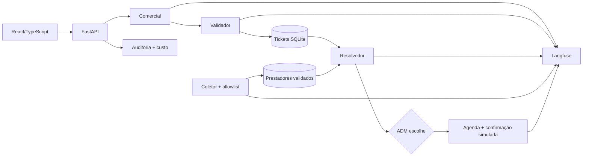

# Plano inicial — SmartRepair AI

## Prazo confirmado e hipóteses a confirmar antes do gate S1

Prazo confirmado pelo time: **22h41m restantes até a submissão do MVP**, contados do momento da mensagem; a hora absoluta da submissão e a data do Demo Day ainda precisam ser registradas. Hipóteses pendentes: **não** concorrer ao Desafio Tako; **SQLite** no MVP; agente somente sugere e agenda após escolha e aprovação explícita do **ADM**; cobertura mínima **70% do código novo**. Os quatro humanos são `Dev 1–4` até nomeação. O orçamento de US$ 25 é crédito de **API**, compartilhado entre produto e agentes de desenvolvimento. O Planejador ajusta as hipóteses quando forem confirmadas. Se Tako for obrigatório, abrir task de escopo antes do gate, pois o produto atual atende gestão imobiliária, não RH.

## Visão e valor

Gestores de imóveis de temporada recebem relatos, comparam orçamentos e agendam manutenção em dias livres sem perder a decisão de contratação. Demo: um hóspede relata vazamento; triagem cria ticket; prestadores simulados respondem; ADM compara propostas; agente encontra janela livre, agenda com prestador simulado e mostra trilha auditável. O protótipo React/Vite existente em `src/` já mostra o fluxo com `localStorage`; T2 o migra e T7 o conecta ao backend.

## Requisitos funcionais

1. **Comercial (Nó 1):** atendimento caloroso e dúvidas sobre imóvel; detectar relato de problema e encaminhar ao Validador sem perder `run_id`.
2. **Validador (Nó 2):** classificar categoria, urgência e local; gerar ticket Pydantic v2; pedir esclarecimento quando faltarem dados essenciais.
3. **Coletor (Nó S):** serviço separado que consulta top 5 por categoria/região, valida contato antes de persistir e alimenta DB; no MVP a fonte é fixture/allowlist. Avaliar Google Places API oficial como adaptador opcional, sujeito a chave, preço, termos e prazo. Não fazer scraping de HTML do Maps.
4. **Resolvedor (Nó 3):** ler somente prestadores validados, solicitar orçamentos e disponibilidade, notificar ADM, aguardar escolha, consultar agenda do imóvel, marcar dia com o escolhido e registrar resultado. Sem escolha do ADM, não há contratação nem agendamento externo.
5. **ADM:** painel de ticket, orçamentos, escolha, agenda, status, gasto e log de auditoria. Toda mensagem externa usa apenas números/endpoints simulados ou allowlist aprovada.
6. Marketing, preço e criação de anúncio ficam fora do MVP.

## Arquitetura e contratos

- Python 3.12, FastAPI e Pydantic v2 em **todos** os contratos de agentes, ferramentas e API. `run_id` atravessa mensagens, tickets, cotações, decisões, agenda, spans e log próprio consultável pelo ADM. Eventos de auditoria registram origem, agente/tool, decisão, resultado e horário, com dados sensíveis reduzidos.
- Chamadas diretas ao LLM para Comercial e Validador: sequência linear. LangGraph somente no Resolvedor se o checkpoint de espera pelo ADM e a retomada com agenda exigirem estado persistido/ramificação; T6 deve demonstrar essa necessidade e documentar o grafo. Se API + estado persistido simples bastarem, usar chamadas diretas.
- Camada de entrada: tamanho e formato limitados, sanitização, classificação de instrução maliciosa; conteúdo de hóspede/prestador tratado como dado não confiável. Saída: schema Pydantic, filtros de dados internos, tool allowlist por agente, parâmetros de ferramentas limitados. Segredos em variáveis de ambiente.
- Camada única Featherless: modelo e `max_tokens` por chamada, retries limitados, tokens/custo por `run_id` e agente, reserva atômica do teto antes da chamada e reconciliação com uso real. Endpoint/painel de gasto; corte em tetos por execução, sprint e global; alertas 50/75/90%. Traces Langfuse e log local continuam mesmo em falha de API.
- Persistência SQLite para a demo; adaptadores isolam DB, agenda e prestadores. Dados de demo reinicializáveis. Integrações com calendários e mensageria reais ficam fora do MVP.

## Sprints, gates e paralelismo

Relógio relativo ao momento em que o time informou o prazo: **S0 0–1h**, **S1 1–6h**, **S2 6–15h**, **S3 15–22h41m**. S0 inclui o gate inicial; o time precisa converter esses marcos para horas absolutas imediatamente. Cada sprint começa após plano/custo aprovados pelo Revisor. Termina após todas as tasks aprovadas, incremento demonstrado, testes verdes, trace Langfuse, custo real medido e `STATUS.md` sem crítico. Desvio >25% do estimado exige justificativa e replanejamento antes da próxima sprint. Prioridade de entrega: fluxo demonstrável → link testável → vídeo e descrição → polimento.

### S0 — preparar execução (0–1h)

| Task / dono / arquivos reservados | Objetivo e dependências | DoD e aceite verificável |
| --- | --- | --- |
| **P0** Dev 1 + Planejador/Revisor; `docs/PLAN.md`, `docs/COST.md`, `docs/STATUS.md`, `docs/CONTRIBUTING.md`, `agents/*.md` | Confirmar hipóteses, conta Featherless, donos e gate. Sem dependência. | Revisor valida tempo, custo, arquivos, critérios e reserva; quatro devs conhecem suas tasks; preços/modelos revistos no catálogo. |

### S1 — base e contratos (1–6h)

| Task / dono / arquivos reservados | Objetivo, requisitos e dependências | DoD e aceite verificável |
| --- | --- | --- |
| **T1** Dev 1; `backend/contracts/`, `backend/api/`, `backend/pyproject.toml`, `tests/contracts/` | Criar schemas Pydantic, FastAPI, IDs e endpoints mínimos. Depende P0. Contratos/configs são task dedicada. | Schemas validam ticket, cotação, escolha e agenda; `run_id` obrigatório; payload inválido retorna 422; ruff/mypy/pytest passam. |
| **T2** Dev 2; `frontend/`, `src/`, `package.json`, `package-lock.json`, `vite.config.js`, `index.html` | Migrar protótipo para React + TypeScript e preparar UI para API. Depende P0. | `npm run build`, lint, typecheck e vitest passam; estados principais do protótipo preservados; UI continua navegável. |
| **T3** Dev 3; `backend/core/`, `backend/observability/`, `tests/cost/` | Orçamento, tetos, alertas, auditoria e Langfuse. Depende T1. | Tests cortam execução/global, disparam 50/75/90%, correlacionam custo e trace por `run_id`; endpoint de gasto protegido. |
| **T4** Dev 4; `backend/providers/`, `tests/providers/`, `infra/demo-data/` | Coletor com fixture top 5 e validação de contato; avaliar Places. Depende T1. | Apenas contatos validados entram no DB; fonte e região registradas; nenhuma mensagem a terceiros; decisão Places documentada. |

T1 e T2 podem iniciar juntos. T3 e T4 começam após contrato T1 aprovado e podem correr em paralelo entre si e com T2; não compartilham arquivos editáveis.

### S2 — fluxo ponta a ponta (6–15h)

| Task / dono / arquivos reservados | Objetivo, requisitos e dependências | DoD e aceite verificável |
| --- | --- | --- |
| **T5** Dev 1; `backend/agents/commercial.py`, `backend/agents/validator.py`, `tests/agents/triage/` | Conversa, detecção de problema, triagem e guardrail. Depende T1/T3. | Dúvida recebe resposta; vazamento vira ticket com categoria/urgência/local; injection não vira instrução; custo e `run_id` rastreados. |
| **T6** Dev 3; `backend/agents/resolver.py`, `backend/scheduling/`, `tests/agents/resolver/` | Cotações, espera ADM, agenda e confirmação simulada. Depende T1/T3/T4. | 2+ orçamentos apresentados; sem aprovação não agenda; escolhe dia sem hóspede; conflito de agenda falha fechado; trace completo. |
| **T7** Dev 2; `frontend/` | Ligar painel aos endpoints e aprovação humana. Depende T1/T2; usar contrato aprovado. | Fluxo visível até decisão e confirmação; erro/espera claros; painel de gasto e auditoria acessíveis ao ADM. |
| **T8** Dev 4; `tests/integration/`, `tests/security/` | Suíte de fluxos mockados, injections e limites. Depende T5/T6. | Fluxo 1→2→S→3→ADM coberto; injection de hóspede e prestador bloqueada; limites/allowlist testados; testes verdes. |

T5, T6 e T7 têm arquivos exclusivos e podem correr em paralelo após dependências. T8 começa após T5/T6; mudanças de contrato ou configuração voltam a task dedicada serial.

### S3 — validar e submeter (15–22h41m)

| Task / dono / arquivos reservados | Objetivo, requisitos e dependências | DoD e aceite verificável |
| --- | --- | --- |
| **T9** Dev 1; `tests/e2e/`, `docs/COST.md` (janela serial com Planejador) | E2E real, medir custo e correções pontuais em task `fix` separada. Depende S2. | Run real do cenário principal com trace e custo; diferença estimado/real registrada; limites preservam reserva. |
| **T10** Dev 2; `infra/`, `docs/DEPLOY.md` | Publicar link testável e plano de saúde. Depende S2; pré-verificar hosting em S0. | **Até t+19h:** URL abre em navegador externo, demo resetável, healthcheck e segredo fora do código. |
| **T11** Dev 3; `docs/PITCH.md`, `docs/VIDEO.md`, `docs/demo-day/` | Pitch, vídeo e material Demo Day. Depende fluxo demonstrável; roteiro pode ser preparado em S2 sem tocar arquivos de outras tasks. | **Até t+20h:** vídeo reproduz cenário; pitch cobre dor, solução, diferencial criativo, startup, custos e mercado; ensaio cronometrado. |
| **T12** Dev 4; `docs/SUBMISSION.md`, `docs/TOOLS.md`, `infra/demo-data/` | Conferir descrição, vídeo, link, material e lista de ferramentas; plano B offline. Depende T10/T11. | **Até t+22h:** checklist de submissão completo e links testados; dados de demo e gravação de backup prontos; ensaio com falha de API realizado. Deixar 41 min para envio e conferência do recibo. |

T9, T10 e T11 usam arquivos diferentes. T12 só fecha depois de T10/T11; acesso a `infra/demo-data/` de T4 já terminou. O Planejador é dono serial do ajuste final em `COST.md` após evidência de T9. Se o Demo Day ocorrer depois da submissão, manter o restante da reserva e o material de apresentação para essa data.

## Testes e validação final

- Unitários: schemas, classificação de urgência, ferramentas, filtros, tetos, alertas, agenda.
- Integração: cada passagem e retomada ADM com Featherless mockado; `run_id` igual em DB, log e trace.
- Segurança: suíte de prompt injection em relatos e respostas de prestadores, exfiltração, tool não permitida, payload longo, schema inválido e tentativa de contratação sem ADM.
- Custo: corte por execução/sprint/global, alertas, contagem por agente e comparação Langfuse versus ledger próprio dentro de ±25%; mock por padrão, modelo real somente em teste marcado.
- E2E: cenário principal com modelos reais e prestadores allowlist/simulados; registrar latência, custo e evidência visual.
- Demo Day: reset de dados, usuário ADM, link testável, vídeo local, roteiro de 3–5 minutos ajustável às regras, ensaio cronometrado e plano B com vídeo/fixture se API cair. Dev 4 confere descrição, vídeo, link, material e ferramentas; Dev 3 entrega vídeo/material; Dev 2 garante link. Verificar regras de submissão reais quando publicadas.

## Riscos e decisões

| Risco | Resposta |
| --- | --- |
| Prazo, Tako, autonomia, banco e cobertura não confirmados | Gate S1 bloqueia escolhas definitivas; Planejador revisa hipóteses sem reescrever código já iniciado. |
| Crédito Featherless de US$ 25 pode não equivaler a plano API ativo | Testar acesso e saldo em P0; sem API, demo simulada e vídeo de backup, mas E2E real depende de acesso. |
| Coleta Google Maps/termos/preço | MVP usa fixture validada; integração Places oficial só se couber no prazo e orçamento externo próprio; sem scraping HTML. |
| Contato externo e privacidade | Allowlist, aprovação explícita, dados mínimos e log sem segredos. |
| Latência/falha LLM ou modelo barato insuficiente | Timeout, retry limitado, fallback pré-orçado, teste de qualidade com exemplos em português e plano B gravado. |
| Conflito entre quatro devs | Arquivos exclusivos por task, contrato antecipado, PRs pequenos e integração serial em `develop`. |

## Perguntas em aberto para os humanos

1. Qual é a data/hora absoluta de submissão e quando ocorrerá o Demo Day? O intervalo restante de 22h41m foi informado, mas não esses marcos.
2. O time concorre ao Desafio Tako? Se sim, qual caso de uso de RH deve ser demonstrado e qual parte do produto atual pode mudar?
3. O ADM sempre aprova a contratação? Envio de pedido de orçamento e agendamento em allowlist também exigem aprovação individual?
4. SQLite basta para a demo ou há Postgres/hosting já disponível?
5. A cobertura mínima desejada é 70% do código novo? Os critérios do hackathon exigem outro valor?
6. Os US$ 25 são créditos de API Featherless já ativos? Qual conta/chave compartilhada e qual saldo atual? Não colocar credenciais no documento.
7. Quem são Dev 1–4, quem é o dono da submissão final e onde será hospedado o link testável?
8. Existe agenda de imóvel real, API Places liberada, lista de prestadores de teste e regra oficial de duração/formato do pitch/vídeo?
