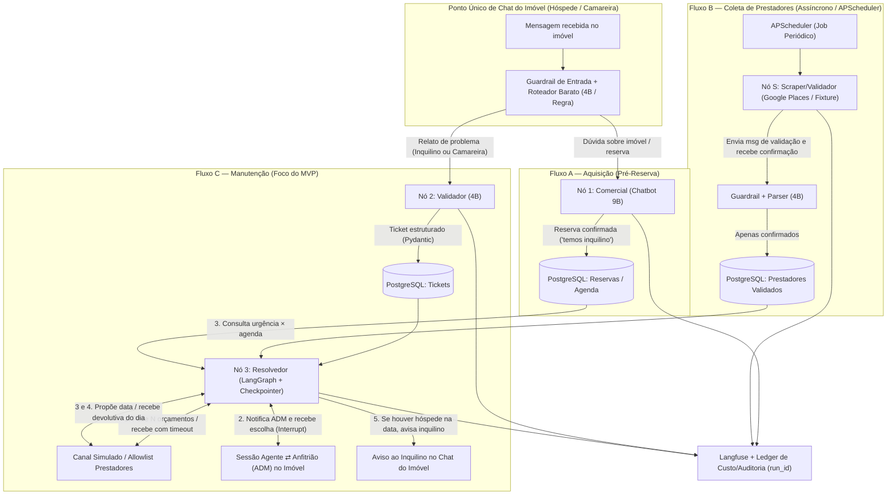
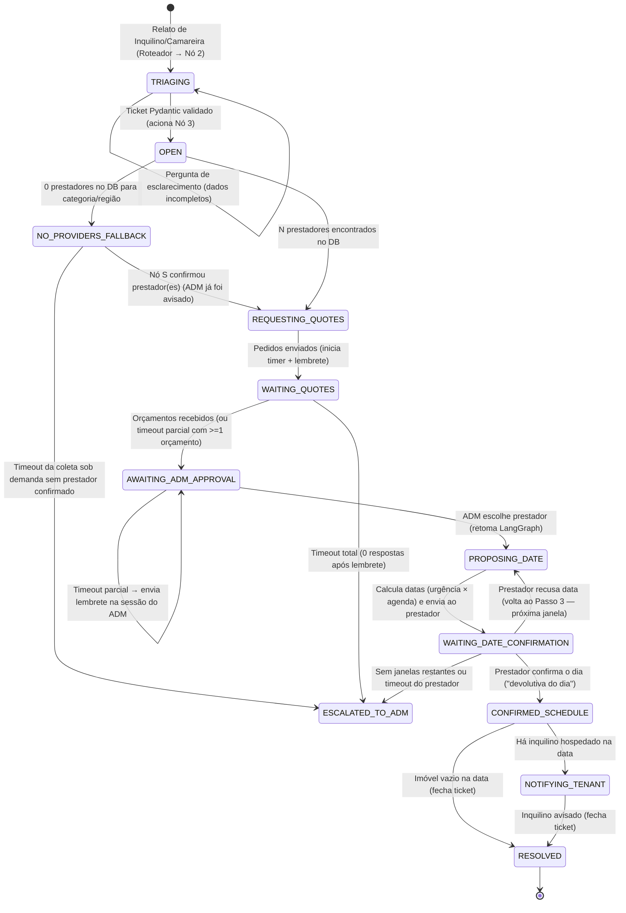

# Plano de Implementação (`PLAN.md`)

Atualizado em: `2026-11-07` (Fonte única da verdade do planejamento do projeto consolidada).

---

## 1. Decisões Confirmadas pelo Time

1. **Prazo e Sprints:** Janela de **24h a 30h** até o Demo Day, organizada em **4 sprints curtas (S0 a S3)**, criando `backend/` e `frontend/` do zero (repositório limpo, sem legado em `src/`).
2. **Orçamento Featherless (US$ 25,00):** Exclusivo para os agentes de negócio que rodam no sistema (os 3 agentes de desenvolvimento — Planejador, Implementador e Revisor — rodam fora da Featherless). **Reserva obrigatória de 30% (US$ 7,50)** bloqueada para os testes finais E2E, ensaio e Demo Day; o teto máximo antes da reserva é de **US$ 17,50**.
3. **Estratégia Mock-First:** Durante o desenvolvimento inicial e testes automatizados de unidade/integração (S1 e S2), **usamos apenas dados mockados e simulações (custo US$ 0,00)**. Os modelos reais pagos na Featherless entram na etapa final de validação/calibração (fim da S2 e S3).
4. **Experiência do Produto (Simulação estilo Airbnb):**
   - A interface simula uma plataforma simples estilo Airbnb organizada por imóvel (`property_id`).
   - Cada imóvel possui um **ponto único de chat** (com um **roteador barato** que direciona dúvidas de reserva para o **Nó 1** e relatos de problemas de inquilinos/camareiras para o **Nó 2**).
   - Dentro da página de cada imóvel, há uma **sessão exclusiva de comunicação entre o Anfitrião (ADM) e o Agente (Nó 3)**, onde o agente apresenta orçamentos, solicita aprovação de contratação e informa o andamento do agendamento.
5. **Autonomia (Humano no Loop):** O Nó 3 **não negocia preço** e **nunca contrata sozinho**; ele coleta orçamentos dos prestadores validados, apresenta ao ADM na sessão do imóvel e aguarda a escolha explícita do ADM antes de agendar a data.
6. **Stack Confirmada:**
   - **Backend:** Python 3.12, FastAPI, Pydantic v2, LangGraph (restrito ao Nó 3 para persistência de estado, esperas longas e `interrupt` do ADM/prestador), **APScheduler** (para o job periódico do Nó S e verificação de timeouts/lembretes).
   - **Banco de Dados:** **PostgreSQL** (via Docker Compose em `infra/`), armazenando imóveis, reservas/agenda, prestadores validados, tickets, checkpoints do LangGraph, auditoria e ledger de custos.
   - **Frontend:** React + TypeScript + Vite (visão estilo Airbnb por imóvel, chat do hóspede/camareira, sessão Agente ⇄ Anfitrião/ADM, simulador de respostas de prestadores e painel de gastos/auditoria).
   - **Observabilidade:** Langfuse (com *model definitions* cadastradas e envio explícito do custo calculado por geração).
   - **Qualidade e Cobertura:** `ruff`, `mypy`, `pytest`, `eslint`, `vitest`, com **cobertura mínima de 70% no código novo**.
7. **Desafio Tako:** O projeto **não** concorre ao Desafio Tako (foco 100% em gestão de imóveis de temporada).

---

## 2. Visão do Produto e Arquitetura dos 3 Fluxos Independentes

O sistema resolve de ponta a ponta o atendimento a hóspedes e a gestão de manutenção de imóveis de temporada por meio de **três fluxos independentes**, conectados apenas pelo banco **PostgreSQL** e pelo `property_id`, além de um **Roteador de Entrada** no chat do imóvel:

> **Diferença em relação ao diagrama Excalidraw do time:** o diagrama manda o relato direto ao Nó 2. Este plano acrescenta o **Roteador de Entrada (R)** porque hóspede e camareira usam o mesmo chat do imóvel. O diagrama deve ser atualizado para incluir o nó R.

### Responsabilidade de Cada Nó

| Nó | Agente / Componente | Responsabilidade | Uso de LLM / Grafo |
| --- | --- | --- | --- |
| **R** | **Roteador de Entrada** | Recebe mensagens no ponto único de chat do imóvel e classifica se é dúvida comercial (→ Nó 1) ou problema de manutenção de inquilino/camareira (→ Nó 2). | Regra determinística + chamada direta `Qwen3.5-4B` (sem LangGraph). |
| **X** | **Marketing** *(opcional)* | Criação de anúncio (preço e descrição). **Fora do MVP.** | — |
| **1** | **Comercial (Chatbot)** | Conversa de forma calorosa com o potencial cliente e tira dúvidas sobre o imóvel até confirmar a reserva. **Seu papel termina quando há inquilino.** | Chamada direta `Qwen3.5-9B` (sem LangGraph). |
| **2** | **Validador (Chatbot)** | Recebe o problema relatado pelo **inquilino ou pela camareira**, faz perguntas de esclarecimento se faltar informação essencial, classifica (**categoria**: encanador, eletricista, pintor, organizador, manutenção geral; **urgência**; **local no imóvel**) e gera um ticket estruturado (schema Pydantic). Aciona o Nó 3. | Chamada direta `Qwen3.5-4B` com saída estruturada Pydantic (sem LangGraph). |
| **S** | **Scraper / Validador de Prestadores** | Job **periódico e assíncrono** (`APScheduler`, não acionado por ticket) que extrai prestadores por categoria/região (Google Places API ou fixture), envia mensagem para validar o contato, recebe a confirmação e **grava no PostgreSQL apenas prestadores que confirmaram**. Possui `run_id` próprio por execução do job. | Job Python + chamada direta `Qwen3.5-4B` para validar resposta (sem LangGraph). |
| **3** | **Resolvedor** | Orquestra o ciclo de resolução do ticket consumindo o DB de prestadores validados e a agenda do imóvel: pede orçamentos, notifica o ADM na sessão do imóvel, agenda a data com o prestador escolhido conforme a urgência e avisa o inquilino se estiver hospedado. | **LangGraph** (justificado por estado persistido, ramificações de timeout/recusa e `interrupt` humano no loop). |
| **ADM** | **Gestor / Anfitrião (Humano)** | Na sessão exclusiva de comunicação com o agente dentro do imóvel, visualiza os orçamentos comparados, seleciona o prestador e devolve a decisão ao Nó 3. | Interface React + TypeScript. |

### Sequência Exata do Nó 3 (Resolvedor)

1. **Coleta de Orçamentos:** Consulta o PostgreSQL buscando `N` prestadores validados para a categoria e região do imóvel. *(Fallback assíncrono: se o DB não tiver prestadores para a categoria/região, o ticket entra em `NO_PROVIDERS_FALLBACK`, o ADM é avisado **na hora** e uma coleta sob demanda do Nó S é enfileirada. Como o Nó S espera a confirmação dos prestadores, o Nó 3 **não bloqueia**: fica em espera com timeout e só volta a `REQUESTING_QUOTES` quando houver prestador confirmado; no timeout, escala ao ADM.)* Envia pedido de orçamento (sem negociar preço) e aguarda respostas com timeout e lembrete.
2. **Aprovação do ADM (Humano no Loop):** Notifica o ADM na **sessão Agente ⇄ Anfitrião do imóvel** com os orçamentos recebidos (em estado `interrupt` do LangGraph); o ADM seleciona o prestador e devolve a escolha ao Nó 3.
3. **Proposta de Datas (Regra de Urgência × Agenda):** Consulta a tabela de reservas/agenda do imóvel e propõe datas ao prestador escolhido:
   - **Urgente** (ex.: vazamento de água, falta de energia elétrica): propõe a janela mais próxima possível, **mesmo com hóspede no imóvel**.
   - **Não urgente** (ex.: pintura, organização, reparo estético): filtra e propõe preferencialmente **dias sem hóspede**.
4. **Confirmação do Dia ("Devolutiva do Dia"):** Aguarda a resposta do prestador escolhido sobre a data proposta. **Se o prestador recusar a data, o fluxo volta ao passo 3** para propor a próxima janela compatível (ou aciona o ADM se esgotarem as janelas).
5. **Aviso ao Inquilino e Fechamento:** Se houver inquilino hospedado na data confirmada da manutenção, envia aviso cordial ao inquilino informando dia e horário. Registra o agendamento na agenda do imóvel, grava a trilha de auditoria e fecha o ticket.

---

## 3. Máquina de Estados do Ticket (Fluxo C)

> Os estados são exatamente os membros de `TicketStatus` e as setas são exatamente `TICKET_TRANSITIONS` (`backend/app/schemas/common.py`). O teste `test_ticket_transitions_match_plan_state_machine` falha se diagrama e código divergirem: mudar um exige mudar o outro na mesma task. Toda mudança de status passa por `is_valid_ticket_transition`, o que impede, por exemplo, pular a aprovação do ADM.

### Contrato Nó 2 → Nó 3

O Nó 2 grava o ticket no PostgreSQL (status `OPEN`) e chama `ResolverStarter.start_resolution(ResolutionRequest(ticket_id, run_id))`, definido em `backend/app/schemas/resolver.py`. O imóvel e os demais dados o Nó 3 lê do próprio ticket (fonte única). A S2-T5 usa um *fake* desse protocolo nos testes; a S2-T6 fornece a implementação (idempotente por `ticket_id`) e a anota como `ResolverStarter` em `app/`, para o `mypy app` checar a assinatura. Nenhuma das duas edita arquivos da outra.

---

## 4. Requisitos Funcionais e Não Funcionais

### Requisitos Funcionais (RF)
- **RF1 — Ponto Único de Chat e Roteador:** Interface de chat por imóvel onde o hóspede ou a camareira envia mensagens. O papel (`reported_by_role`) vem da sessão/perfil escolhido na UI e é gravado pelo backend, nunca inferido pelo LLM a partir do texto; o roteador classifica e encaminha dúvidas comerciais ao Nó 1 e relatos de manutenção ao Nó 2.
- **RF2 — Fluxo A (Nó 1 Comercial):** Responde dúvidas sobre o imóvel com tom acolhedor usando os dados cadastrados do imóvel e cria uma **pré-reserva** no PostgreSQL. A reserva só é confirmada por ação explícita do hóspede na UI (botão), nunca por decisão do LLM.
- **RF3 — Fluxo B (Nó S Coletor Periódico):** Job agendado no `APScheduler` que consulta Google Places API (ou fixture em dev), dispara mensagem de validação de contato (**na demo, só para fixture, simulador ou números da allowlist dos devs**; nunca para contatos reais do Google Places sem aprovação explícita do time), interpreta a confirmação e salva apenas prestadores validados no PostgreSQL com `run_id` próprio do job.
- **RF4 — Fluxo C / Triagem (Nó 2 Validador):** Recebe relatos de inquilinos ou camareiras, pede esclarecimentos quando necessário e produz `MaintenanceTicket` tipado em Pydantic v2 (`category`, `urgency`, `location_in_property`, `description`, `reported_by_role`).
- **RF5 — Fluxo C / Resolução (Nó 3 Resolvedor):** Executa os 5 passos em LangGraph com persistência de estado, timeouts/lembretes, regra `urgência × agenda`, loop em caso de recusa de data e aviso ao inquilino hospedado.
- **RF6 — Sessão Agente ⇄ Anfitrião (ADM) por Imóvel:** Área exclusiva dentro da página de cada imóvel na interface estilo Airbnb onde o ADM conversa/interage com o agente, visualiza os tickets ativos daquele imóvel, compara os orçamentos recebidos, aprova o prestador escolhido e acompanha a agenda e os alertas de timeout.
- **RF7 — Simulador de Interações para a Demo:** Painel auxiliar na UI permitindo simular em tempo real as respostas dos prestadores (envio de orçamento, confirmação ou recusa de data) e mensagens de inquilino/camareira para demonstrar todos os caminhos na apresentação.

### Requisitos Não Funcionais (RNF — Obrigatórios)
- **RNF1 — Custo:** Toda chamada ao LLM define `model` e `max_tokens`, verifica tetos antes de executar e registra tokens e custo real (por `run_id`, por agente, por sprint e global). Endpoint e painel de gastos com alertas em 50%, 75% e 90% e corte automático em 100%.
- **RNF2 — Segurança e Guardrails:**
  - *Entrada:* Todas as mensagens de hóspedes, camareiras e prestadores são tratadas como **entrada não confiável**, passando por sanitização e detecção de prompt injection antes de chegarem aos prompts principais.
  - *Ações críticas determinísticas:* aprovar prestador, confirmar reserva e agendar data só acontecem por endpoint autenticado chamado pela UI do ADM/hóspede. Essas ações **não existem como ferramenta do LLM**; o guardrail por LLM é uma camada extra, não a garantia principal.
  - *Saída:* Validação estrita por schema Pydantic v2, filtro contra vazamento de instruções internas/dados de outros imóveis, allowlist de ferramentas por agente e allowlist de destinatários de mensagens. Segredos exclusivamente via variáveis de ambiente (`.env`).
- **RNF3 — Privacidade e LGPD:** Telefones de prestadores e dados pessoais de hóspedes (telefone, e-mail, documento) ficam armazenados **apenas no PostgreSQL**; um redator automático mascara PII (`***`) antes de gravar qualquer log de aplicação, evento de auditoria ou trace/span enviado ao Langfuse.
- **RNF3.1 — Base legal e retenção (LGPD):** dados de prestadores vindos do Google Places são tratados por legítimo interesse (contato comercial) e só ficam ativos após o prestador **confirmar** a mensagem de validação, que informa a finalidade e permite recusa; quem recusa ou não responde tem o contato removido. Dados de hóspedes ficam restritos ao imóvel e à reserva. Na demo, só dados fictícios ou dos próprios devs.
- **RNF4 — Auditabilidade:** Cada ticket do Fluxo C mantém o mesmo `run_id` desde a mensagem inicial até o aviso final ao inquilino; cada execução do Nó S mantém o `run_id` do job. É possível reconstruir no painel de auditoria do ADM e no Langfuse onde o fluxo começou, por quais nós/ferramentas passou, o que decidiu e onde terminou.
- **RNF5 — Resiliência:** Timeouts e lembretes configuráveis nas esperas por prestador e ADM; nenhum ticket fica parado sem estado visível na sessão do imóvel.

---

## 5. Divisão de Sprints, Paralelismo e Tasks (4 Devs)

Relógio de referência (24h–30h):
- **Sprint 0 (0h–2h):** Alinhamento, setup do repositório, PostgreSQL via Docker Compose e contratos base.
- **Sprint 1 (2h–9h):** Fundação em paralelo — Contratos/DB, Guardrails/LLM Wrapper/Langfuse/Custos, Nó S + APScheduler, e Shell Frontend estilo Airbnb.
- **Sprint 2 (9h–20h):** Fluxos de negócio ponta a ponta (com LLM mockado por padrão) — Roteador + Nó 1 + Nó 2, Nó 3 (LangGraph + Agenda), Integração Frontend (Sessão Agente ⇄ ADM + Simulador), e Suíte de Integração/Segurança.
- **Sprint 3 (20h–28h+):** Ativação dos modelos reais na Featherless, E2E real, recalibração de custo, deploy do link testável, vídeo, pitch e pacote de submissão do Demo Day.

### Sprint 0 — Setup e Gate Inicial (0h–2h)

| Task | Dono | Branch | Arquivos Reservados | Objetivo, Dependências e DoD / Critérios de Aceite |
| --- | --- | --- | --- | --- |
| **S0-T0** | Dev 1 + Planejador / Revisor | `docs/s0-t0-planejamento-v2` | `docs/*.md`, `agents/*.md`, `README.md` | **Objetivo:** Consolidar o planejamento único v2, criar branch `develop` e validar o Gate S0. **DoD / Aceite:** `PLAN.md`, `COST.md`, `STATUS.md`, `CONTRIBUTING.md` e `agents/*.md` aprovados pelo Revisor; preços da Featherless e reserva de 30% documentados. |

---

### Sprint 1 — Fundação, Contratos, Controle de Custo e Shell Airbnb (2h–9h)

*Regra de paralelismo:* **S1-T1** fecha os contratos Pydantic e modelos SQL primeiro (primeiras 2h da S1) enquanto **S1-T4** cria o frontend em paralelo. Depois da **S1-T1**, roda a **S1-T2**. A **S1-T3** depende de T1 **e** T2 (usa cliente LLM, guardrail e mascaramento), então **não** é paralela à S1-T2. A **S1-T13** (ajuste de contratos e do corte de orçamento) precisa estar aprovada antes da S2. Ela pode rodar em paralelo à S1-T3 porque os arquivos de código são disjuntos; o único arquivo comum é `docs/STATUS.md`, atualizado de forma atômica (CONTRIBUTING §4), e quem fizer merge depois faz rebase.

| Task | Dono | Branch | Arquivos Reservados | Objetivo, Requisitos, Dependências e DoD / Critérios de Aceite |
| --- | --- | --- | --- | --- |
| **S1-T1** | Dev 1 | `feature/s1-t1-db-contracts` | `infra/docker-compose.yml`, `backend/pyproject.toml`, `backend/app/main.py`, `backend/app/db/`, `backend/app/schemas/`, `tests/unit/test_schemas.py` | **Objetivo:** Configurar PostgreSQL no Docker Compose, modelos relacionais (Imóveis, Reservas/Agenda, Prestadores, Tickets, Orçamentos, Auditoria, Gastos) e todos os contratos Pydantic v2. **Depende de:** S0-T0. **DoD / Aceite:** `docker compose up -d db` sobe Postgres; schemas validam entradas/saídas de todos os nós com `run_id` obrigatório; seed inicial pré-popula 3 imóveis (estilo Airbnb), agenda de ocupação e prestadores validados; `ruff`, `mypy` e `pytest` verdes (≥70% cobertura). |
| **S1-T2** | Dev 3 | `feature/s1-t2-llm-cost-security` | `backend/app/core/`, `backend/app/security/`, `backend/app/observability/`, `tests/unit/test_cost_and_security.py` | **Objetivo:** Implementar cliente unificado LLM (`mock` por padrão + `featherless`), controle de orçamento (tetos por `run_id`, sprint e global + alertas 50/75/90%), guardrails de entrada/saída, mascaramento LGPD (telefones/dados de hóspedes) e integração Langfuse com envio explícito de custo. **Depende de:** S1-T1. **DoD / Aceite:** Chamada sem `max_tokens` ou fora da tabela falha em tempo de execução; teto corta chamada ao atingir 100%; números de telefone são mascarados em logs e spans Langfuse; testes unitários de custo e prompt injection passam. |
| **S1-T3** | Dev 4 | `feature/s1-t3-node-s-scheduler` | `backend/app/services/provider_collector.py`, `backend/app/scheduler/`, `backend/app/api/providers.py`, `tests/unit/test_node_s.py` | **Objetivo:** Implementar o **Fluxo B (Nó S)** como job periódico no `APScheduler` (e gatilho sob demanda, **assíncrono**, para o fallback do Nó 3), com adaptador de **fixture primeiro** (MVP) e Google Places API como extra se sobrar tempo, envio de mensagem de validação de contato e gravação no Postgres apenas após confirmação. **Depende de:** S1-T1, S1-T2. **DoD / Aceite:** Job gera `run_id` próprio; prestador que não confirma contato **não** entra como ativo no DB; nenhuma mensagem é enviada fora da allowlist/simulador; testes unitários cobrem confirmação, recusa e fallback; `backend/app/scheduler/` expõe um registro genérico (`register_job(...)`) que outras tasks usam **sem editar** a pasta. |
| **S1-T4** | Dev 2 | `feature/s1-t4-frontend-airbnb-shell` | `frontend/`, `infra/frontend.Dockerfile` | **Objetivo:** Criar aplicação React + TypeScript + Vite simulando a plataforma estilo Airbnb: listagem de imóveis, página do imóvel com calendário de ocupação, aba do **Ponto Único de Chat** (hóspede/camareira), aba exclusiva da **Sessão Agente ⇄ Anfitrião (ADM)** e cabeçalho com monitor de orçamento. **Depende de:** S0-T0 (paralela à S1-T1). **DoD / Aceite:** `npm run lint`, `npm run typecheck`, `npm run test` (vitest) e `npm run build` limpos; navegação entre imóveis e abas funcionando com contratos tipados. |
| **S1-T13** | Dev 1 + Planejador / Revisor | `fix/s1-t13-ticket-contract-docs` | `backend/app/schemas/common.py`, `backend/app/schemas/resolver.py`, `backend/app/schemas/__init__.py`, `backend/app/core/budget.py`, `backend/app/core/config.py`, `backend/app/core/__init__.py`, `backend/.env.example`, `tests/unit/test_schemas.py`, `tests/unit/test_cost_and_security.py`, `docs/PLAN.md`, `docs/COST.md`, `docs/CONTRIBUTING.md`, `docs/STATUS.md` (só a linha da S1-T13) | **Objetivo:** Alinhar `TicketStatus` à máquina de estados (adiciona `NO_PROVIDERS_FALLBACK` e `WAITING_QUOTES`) e codificar as transições (`TICKET_TRANSITIONS`); criar o contrato Nó 2 → Nó 3 (`ResolutionRequest` + `ResolverStarter`); fazer o corte de orçamento respeitar a reserva de 30% (`BUDGET_RESERVE_UNLOCKED`); corrigir as inconsistências dos docs. **Depende de:** S1-T1, S1-T2. **DoD / Aceite:** teste garante estados e transições = diagrama do PLAN; antes da S3 o corte global ocorre em US$ 17,50; `ruff`, `mypy` e `pytest` verdes; nenhuma migração de banco necessária (status é `String(50)`). |

---

### Sprint 2 — Fluxos de Negócio A e C, LangGraph e Integração (9h–20h)

*Regra de paralelismo:* **S2-T5** (Roteador + Nó 1 + Nó 2), **S2-T6** (Nó 3 LangGraph + Agenda) e **S2-T7** (Conexão Frontend + Simulador) atuam em módulos separados e rodam em paralelo. **S2-T8** consolida a suíte de integração e segurança sobre os fluxos prontos.

| Task | Dono | Branch | Arquivos Reservados | Objetivo, Requisitos, Dependências e DoD / Critérios de Aceite |
| --- | --- | --- | --- | --- |
| **S2-T5** | Dev 1 | `feature/s2-t5-router-node1-node2` | `backend/app/agents/router.py`, `backend/app/agents/commercial.py`, `backend/app/agents/validator.py`, `backend/app/api/chat.py`, `tests/unit/test_router_and_triage.py` | **Objetivo:** Implementar o **Roteador Barato** do ponto único de chat, o **Nó 1 (Comercial — Fluxo A)** até a criação de reserva, e o **Nó 2 (Validador — início do Fluxo C)** para relatos de inquilino ou camareira, gerando o ticket estruturado no Postgres para o Nó 3. **Depende de:** S1-T1, S1-T2. **DoD / Aceite:** (1) Roteador aplica regra determinística de custo zero checando chamado aberto no imóvel e remetente camareira antes de chamar LLM (`Qwen3.5-4B`, 48 tokens); (2) Dúvida comercial vai ao Nó 1 (`Qwen3.5-9B`, 256 tokens), valida conflito de datas em `bookings` antes de confirmar e mantém estritamente o contrato `ChatMessageOutput`; (3) Relato de manutenção vai ao Nó 2 (`Qwen3.5-4B`, 256 tokens com `response_format` estruturado), pede esclarecimento se incompleto e cria ticket no Postgres com status `open` e `run_id` único; (4) Toda chamada ao LLM computa gasto no ledger (DB e memória); (5) Testes unitários verdes (≥70% cobertura). |
| **S2-T6** | Dev 3 | `feature/s2-t6-node3-langgraph-resolver` | `backend/app/agents/resolver_graph.py`, `backend/app/agents/resolver_timeouts.py`, `backend/app/services/scheduling.py`, `backend/app/api/tickets.py`, `tests/unit/test_resolver_graph.py` | **Objetivo:** Implementar o **Nó 3 (Resolvedor)** em LangGraph com checkpointer PostgreSQL, `interrupt` para decisão do ADM, timeouts/lembretes registrados no `APScheduler` via `register_job` da S1-T3 (em `resolver_timeouts.py`, sem editar `backend/app/scheduler/`), implementação do `ResolverStarter` e os 5 passos completos (orçamento sem negociar preço → ADM escolhe → regra `urgência × agenda` → confirmação/recusa de data com loop para o passo 3 → aviso ao inquilino se hospedado). **Depende de:** S1-T1, S1-T2, S1-T3, S1-T13. **DoD / Aceite:** Ticket urgente agenda no 1º horário livre mesmo com hóspede e gera aviso ao inquilino; ticket não urgente escolhe dia sem hóspede; recusa de data pelo prestador retorna ao passo 3; agente nunca agenda sem aprovação do ADM; toda mudança de status usa `is_valid_ticket_transition`; implementação anotada como `ResolverStarter`. |
| **S2-T7** | Dev 2 | `feature/s2-t7-frontend-integration` | `frontend/src/` | **Objetivo:** Conectar o frontend React aos endpoints FastAPI: chat unificado do imóvel (mostrando roteamento Nó 1 / Nó 2 e avisos ao inquilino), **Sessão Agente ⇄ Anfitrião (ADM)** no imóvel (comparativo de orçamentos, botão de aprovação do prestador, linha do tempo da máquina de estados), simulador de respostas de prestadores e tela de auditoria/custos. **Depende de:** S1-T4, S2-T5, S2-T6. **DoD / Aceite:** Fluxo completo executável pela UI; ADM aprova orçamento na sessão do imóvel e vê o ticket avançar até a confirmação do dia e aviso ao hóspede; estados de espera/timeout visíveis. |
| **S2-T14** | Dev 3 + Revisor | `feature/s2-t14-provider-real-flow` | `backend/app/agents/resolver_graph.py`, `backend/app/agents/resolver_timeouts.py`, `backend/app/api/tickets.py`, `backend/app/schemas/resolver.py`, `backend/app/main.py`, `tests/unit/test_resolver_graph.py`, `frontend/src/api/client.ts`, `frontend/src/components/ProviderSimulator.tsx`, `frontend/src/App.tsx` | **Objetivo:** Corrigir o Fluxo C apontado na auditoria da develop: o Nó 3 deixa de simular orçamentos e devolutivas com o LLM e passa a **esperar eventos reais** (`interrupt`) do prestador/simulador, do ADM, do Nó S e dos timers. **Depende de:** S1-T13 (transições), S2-T6, S2-T7. **DoD / Aceite:** (1) orçamentos só existem quando o prestador responde em `POST /api/tickets/{id}/quotes/{provider_id}/response`; (2) devolutiva do dia em `POST /api/tickets/{id}/date-response` (recusa volta ao passo 3; 3 recusas escalam); (3) timeouts de orçamento, data e coleta disparam pelo APScheduler da aplicação e retomam o grafo; (4) sem prestador, o Nó S roda em segundo plano e o ticket é retomado quando surge prestador validado (ou escala no timeout); (5) aviso ao hóspede gravado (`tenant_notified`) só quando houver hóspede na data confirmada; (6) texto do prestador passa pelo guardrail; (7) toda mudança de status usa `is_valid_ticket_transition`; (8) simulador da UI responde como prestador. |
| **S2-T8** | Dev 4 | `feature/s2-t8-integration-security-tests` | `tests/integration/`, `tests/security/` | **Objetivo:** Construir suíte completa de testes de integração (com LLM mockado) cobrindo o caminho feliz e **todos os caminhos alternativos exigidos**, além da suíte de segurança (prompt injection de hóspede, camareira e prestador + verificação LGPD). **Depende de:** S2-T5, S2-T6. **DoD / Aceite:** Testes verdes para: (1) nenhum prestador no DB → fallback Nó S / aviso ADM; (2) timeout de prestador; (3) timeout do ADM com lembrete; (4) prestador recusa data → volta ao passo 3; (5) urgente com hóspede vs. não urgente sem hóspede; (6) 100% da suíte de injection bloqueada. |

---

### Sprint 3 — Modelos Reais, E2E, Deploy e Submissão Demo Day (20h–28h+)

*Regra de paralelismo:* Aqui ativamos a reserva de **US$ 7,50** para rodar os testes marcados com os modelos reais da Featherless, calibrar o `COST.md`, publicar o link testável e fechar os entregáveis de avaliação do hackathon.

| Task | Dono | Branch | Arquivos Reservados | Objetivo, Requisitos, Dependências e DoD / Critérios de Aceite |
| --- | --- | --- | --- | --- |
| **S3-T9** | Dev 1 | `fix/s3-t9-real-llm-e2e` | `tests/e2e/`, `docs/COST.md` | **Objetivo:** Executar bateria de qualidade e testes E2E com os modelos reais da Featherless (`Qwen3.5-4B` e `9B`), conferir traces e custos no Langfuse e recalibrar `docs/COST.md`. **Depende de:** S2 concluída. **DoD / Aceite:** E2E real passa de ponta a ponta; traces completos no Langfuse com custo registrado por `run_id`; desvio real vs. estimado documentado em `docs/COST.md` dentro da margem. |
| **S3-T10** | Dev 2 | `feature/s3-t10-deploy-link` | `infra/`, `docs/DEPLOY.md` | **Objetivo:** Publicar o link testável (frontend + backend + PostgreSQL com seed/reset de 1 clique para avaliadores) e validar healthcheck. **Depende de:** S2 concluída. **DoD / Aceite:** URL pública abre em navegador externo, permite testar o fluxo completo e possui botão de "Resetar Dados da Demo" protegido/simples. |
| **S3-T11** | Dev 3 | `docs/s3-t11-pitch-video` | `docs/PITCH.md`, `docs/VIDEO.md`, `docs/demo-day/` | **Objetivo:** Produzir o roteiro e gravação do vídeo de demonstração e o material do Pitch do Demo Day cobrindo os 4 critérios de pesos iguais (protótipo/aderência, viabilidade como startup, pitch, criatividade). **Depende de:** S2 concluída. **DoD / Aceite:** Vídeo gravado mostrando os 3 fluxos (com foco no Fluxo C, sessão Agente ⇄ Anfitrião no imóvel, aprovação humana, agenda e trilha Langfuse); ensaio do pitch cronometrado. |
| **S3-T12** | Dev 4 | `docs/s3-t12-submission-plan-b` | `docs/SUBMISSION.md`, `docs/TOOLS.md` | **Objetivo:** Consolidar pacote obrigatório de submissão (descrição do projeto, link do vídeo, link testável, material do Demo Day e lista completa de ferramentas/modelos) e preparar **Plano B** (modo `LLM_MODE=recorded_demo` com respostas reais pré-gravadas caso a API externa oscile no palco). **Depende de:** S3-T9, S3-T10, S3-T11. **DoD / Aceite:** Todos os 5 itens da submissão conferidos e acessíveis; chave de fallback `recorded_demo` testada em menos de 10 segundos. |

---

## 6. Plano de Testes

1. **Testes Unitários (`tests/unit/`):**
   - Validação de todos os contratos Pydantic v2 (incluindo rejeição de payloads sem `run_id` ou fora do enum de categorias/urgência).
   - Regra determinística de **urgência × agenda**: garantir que chamados urgentes alocam o primeiro horário disponível (marcando `notify_tenant=True` quando há hóspede) e chamados não urgentes selecionam apenas janelas sem reserva ativa.
   - Guardrails de entrada/saída, allowlist de ferramentas por agente e redator LGPD (garantindo que CPF, e-mail e telefones nunca saiam em texto claro para logs/traces).
2. **Testes de Integração com LLM Mockado (`tests/integration/`):**
   - **Caminho principal completo:** Relato no chat do imóvel → Roteador → Nó 2 cria ticket → Nó 3 pede orçamento a 3 prestadores → ADM aprova na sessão do imóvel → Nó 3 propõe data → prestador confirma → inquilino recebe aviso → ticket `RESOLVED`.
   - **Caminhos alternativos obrigatórios:**
     - *Nenhum prestador no DB para a categoria/região:* Nó 3 aciona coleta sob demanda do Nó S ou escala ao ADM.
     - *Prestador sem resposta (timeout):* Timer dispara lembrete e o fluxo prossegue com os orçamentos disponíveis (ou escala ao ADM se zero respostas).
     - *ADM sem resposta (timeout):* Timer registra lembrete na sessão Agente ⇄ Anfitrião mantendo o ticket visível em `AWAITING_ADM_APPROVAL`.
     - *Prestador recusa a data proposta:* Nó 3 retorna automaticamente ao Passo 3 e propõe a próxima janela compatível da agenda.
     - *Inquilino hospedado vs. imóvel vazio:* Verifica disparo condicional do aviso ao inquilino no Passo 5.
3. **Testes de Segurança (`tests/security/`):**
   - Suíte de prompts maliciosos / prompt injection simulando mensagens de **hóspede**, **camareira** e **prestador** (ex.: tentativa de aprovar o próprio orçamento sem o ADM, tentativa de extrair dados de outros imóveis ou alterar preço acordado).
4. **Testes de Custo (`tests/unit/test_cost_and_security.py`):**
   - Validar que o teto por execução (`run_id`), por sprint e global bloqueiam novas chamadas ao atingir 100%, que os alertas de 50%, 75% e 90% são emitidos e que o cálculo enviado ao Langfuse bate com a tabela do `docs/COST.md`.
5. **Testes End-to-End (`tests/e2e/`):**
   - Execução marcada (`@pytest.mark.real_llm`) na Sprint 3 usando os modelos reais da Featherless e dados do simulador/allowlist, validando latência, aderência ao schema em português e custo real no Langfuse.
6. **Checklist Final de Validação para o Demo Day:**
   - [ ] Banco PostgreSQL com seed de 1 clique contendo imóveis estilo Airbnb, reservas ativas/futuras e prestadores pré-validados por categoria.
   - [ ] Sessão Agente ⇄ Anfitrião (ADM) exibindo claramente o comparativo de orçamentos e o botão de aprovação humana.
   - [ ] Painel do Langfuse aberto com os traces do `run_id` e custos calculados visíveis.
   - [ ] Modo Plano B (`LLM_MODE=recorded_demo` / `mock`) pronto caso a internet ou a API oscile durante a apresentação ao vivo.
   - [ ] Conferência final dos 5 entregáveis da submissão: **Descrição**, **Vídeo**, **Link Testável**, **Material do Demo Day** e **Lista de Ferramentas**.

---

## 7. Riscos e Mitigações

| Risco | Impacto | Mitigação |
| --- | --- | --- |
| Consumo acidental dos US$ 25 da Featherless durante desenvolvimento | Alto | `LLM_MODE=mock` como padrão absoluto em dev e CI; modelos reais só rodam na etapa final com tetos rígidos por `run_id` (US$ 0,03) e por sprint. |
| Modelo menor (`Qwen3.5-4B`) falhar em gerar JSON/Pydantic válido em português | Médio | Uso de *structured outputs* / `response_format` com validação Pydantic v2, 1 retry automático com erro de validação injetado e fallback configurado para `Qwen3.5-9B`. |
| Complexidade do LangGraph atrasar a entrega do Nó 3 | Alto | Uso de LangGraph restrito exclusivamente à máquina de estados do Nó 3; Roteador, Nó 1, Nó 2 e Nó S usam funções Python simples e chamadas diretas ao LLM. |
| Conflito de merge entre os 4 desenvolvedores | Médio | Divisão estrita de pastas/arquivos por task nas tabelas acima; alterações em `backend/app/schemas/` só ocorrem em task dedicada. |
| Instabilidade da API externa durante o Pitch no Demo Day | Alto | Modo de contingência (`recorded_demo`) com latência simulada e respostas reais pré-gravadas, além do vídeo já renderizado. |

---

## 8. Perguntas Operacionais Restantes para os Humanos (Não Bloqueantes)

Todas as decisões de arquitetura, escopo, stack e orçamento já foram respondidas e incorporadas acima. Restam apenas confirmações operacionais para preenchimento no `docs/STATUS.md` ao longo da execução:

1. **Nomes dos 4 desenvolvedores:** Quais são os nomes/handles do GitHub correspondentes a `Dev 1`, `Dev 2`, `Dev 3` e `Dev 4`, e quem será o responsável final pelo merge em `main` e pelo envio do formulário de submissão?
2. **Horário exato do corte de submissão:** Qual é o horário limite exato (relógio oficial do evento) para congelar o deploy e enviar os 5 artefatos?
